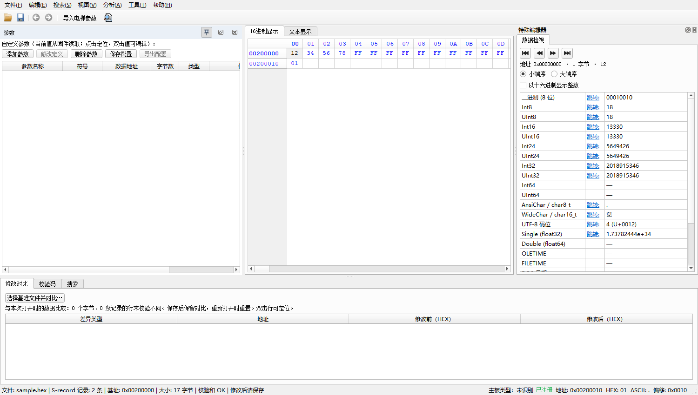
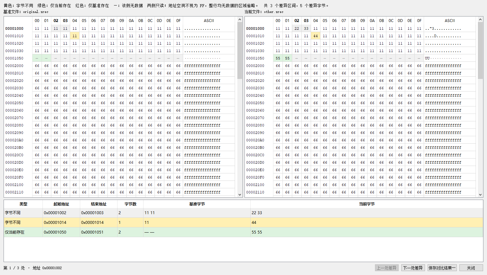
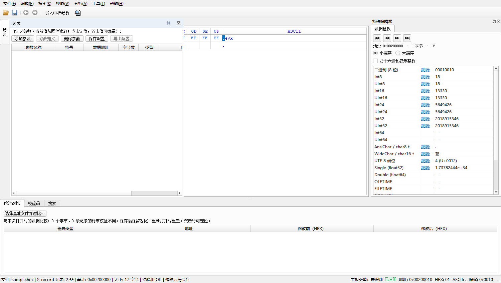

# 三菱电梯程序编辑软件

FirmwareQuickEdit is a Windows HEX firmware editor for Mitsubishi elevator maintenance, with address navigation, byte editing, file comparison, and checksum checking.

维修三菱电梯时，想查地址、改字节、对比文件？这款 Windows 固件编辑器把常用操作放在一个界面里，适合需要手动查看和修改固件数据的维修人员。

## 主要功能

- 支持三菱电梯 HEX 文件编辑和校验检查
- 十六进制数据查看与编辑，可按地址跳转
- 支持十六进制字节序列查找、替换
- 修改前后差异高亮，可查看文件对比结果
- 显示记录校验状态；保存时按文件格式更新记录校验
- 可导入电梯参数，方便记忆和使用
- 可添加自定义参数名称、地址和长度，方便重复查看
- 支持撤销、重做、最近打开文件
- 更改内容自动计算并更新行校验和
- 提供 Windows 32 位免安装版，可在 32 位和 64 位 Windows 运行
- 支持简体中文、英语、日语和韩语界面，可在“设置 → 语言”切换
- 适合做数据查看、手动编辑和文件对比
- 修改后自动备份（每次保留一份 .bak）
- 支持试用

## 软件截图

### 主界面

### 双文件对比

### 参数栏自动隐藏与悬停展开

## 下载

前往 [FirmwareQuickEdit v1.1.174 Releases](https://github.com/heyPython2026/FirmwareQuickEdit/releases/tag/v1.1.174) 下载 32 位免安装包（可在 32 位和 64 位 Windows 运行）。解压后直接运行 `FirmwareQuickEdit-v1.1.174.exe`。压缩包包含 8 组电梯参数配置模板、使用帮助、第三方运行库说明和 SHA-256 校验文件。

## 联系与许可 | Contact and licensing

编辑和保存需要注册授权。软件以可执行文件形式发布，第三方运行库许可说明见发布包。 FirmwareQuickEdit is distributed as an executable. See the release package for third-party notices.

联系邮箱 / Contact: [635873431@qq.com](mailto:635873431@qq.com)
